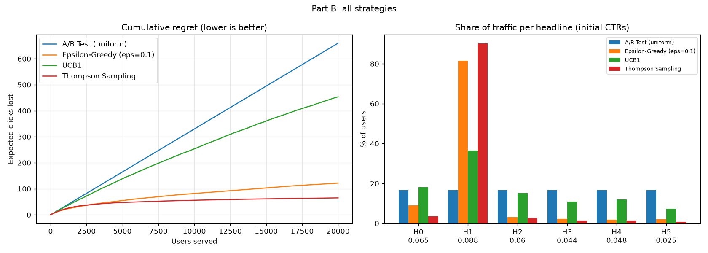
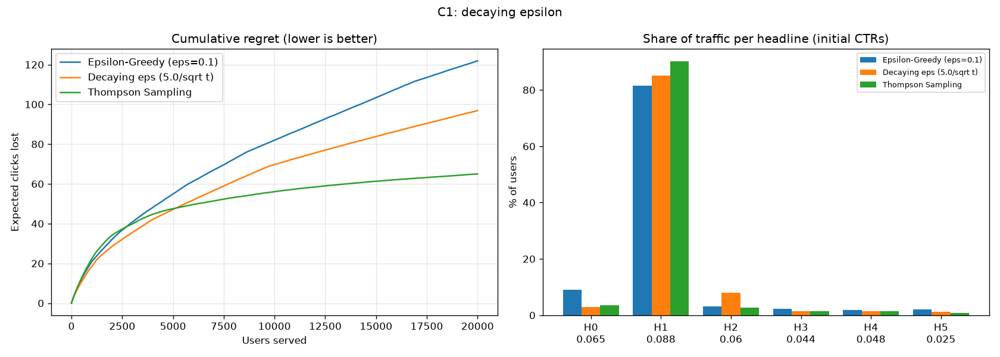
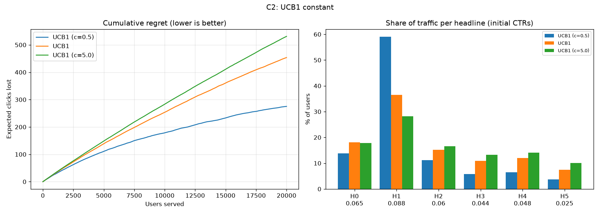
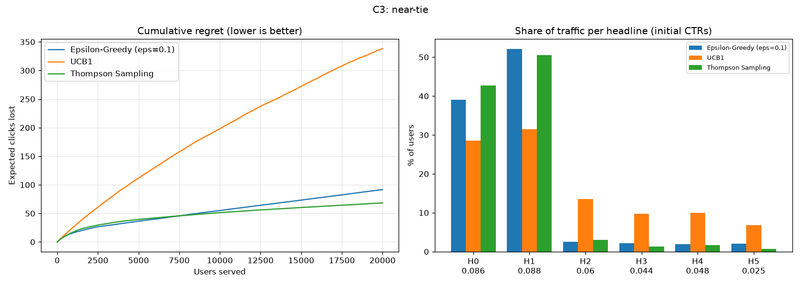
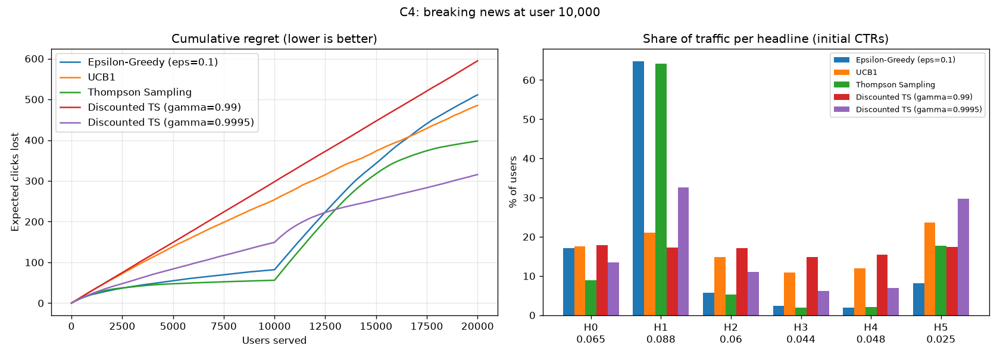

# Results

## Overview

A news platform has 6 candidate headlines for one home-screen slot. Each visitor sees one headline and either clicks (reward 1) or not (reward 0). The goal is to collect as many clicks as possible, which is the same as minimising **cumulative regret**: the expected clicks lost by not always showing the best headline.

## Setup

You receive two files. Put them in the same folder and install the requirements with `pip install numpy matplotlib` or run `pip install -r requirements.txt`.

| File | What it is |
| --- | --- |
| `mab_assignment.py` | Starter code. |
| `check_my_work.py` | Self-check. Run `python check_my_work.py` until all 12 checks pass. |

1. Open `mab_assignment.py` and set `STUDENT_ID`(my id is 36112) at the top to your student ID. Your ID generates your own hidden click-through rates, so every student gets different numbers.
2. Implement Part A, then run `python check_my_work.py`. Each failed check prints a hint.
3. When all checks pass, run `python mab_assignment.py`.

## Part A: Implement UCB1 and Thompson Sampling
### UCB1

Show every headline once first. After that, show the headline with the highest upper confidence bound, where μ̂ᵢ is its observed CTR, Nᵢ is how often it was shown, t is the number of users so far and c is the exploration constant (`self.c`, default 2):

$$A_t = \arg\max_i \left[ \hat{\mu}_i + \sqrt{\frac{c \ln t}{N_i}} \right]$$

```python
class UCB1(BaseAgent):
    def __init__(self, k, c=2.0):
        super().__init__(k)
        self.c = c
        self.name = "UCB1" if c == 2.0 else f"UCB1 (c={c})"
        # TODO (Part A): add any attributes you need (e.g. a counter self.t)
        self.t = 0

    def select_arm(self):
        # TODO (Part A): implement UCB1
        #  1. count this user (t)
        #  2. if some arm has never been shown, return it
        #  3. otherwise return the arm with the largest  mu_i + bonus_i
        ucb1 = np.zeros(self.k)
        self.t += 1
        for i in range(self.k):
            if self.counts[i] == 0:
                return i
            ucb1[i] = self.values[i] + np.sqrt(self.c * np.log(self.t) / self.counts[i])
        return np.argmax(ucb1)
```

### Thompson Sampling

Keep a Beta(αᵢ, βᵢ) belief for each headline's CTR, starting at Beta(1, 1). To choose, draw one sample from every belief with `self.rng.beta` and show the headline with the largest sample. After each user, add 1 to αᵢ on a click or to βᵢ on a non-click:

$$\theta_i \sim \mathrm{Beta}(\alpha_i, \beta_i), \qquad A_t = \arg\max_i \theta_i$$

```python
class ThompsonSampling(BaseAgent):
    name = "Thompson Sampling"
    def __init__(self, k, seed=None):
        super().__init__(k)
        self.rng = np.random.default_rng(seed)
        # TODO (Part A): create self.alpha and self.beta (all ones, length k)
        self.alpha = np.ones(k)
        self.beta = np.ones(k)

    def select_arm(self):
        # TODO (Part A): sample from each arm's Beta belief, return the argmax
        samples = self.rng.beta(self.alpha, self.beta)
        return int(np.argmax(samples))

    def update(self, arm, reward):
        # TODO (Part A): call super().update(arm, reward),
        #                then update alpha and beta for this arm
        super().update(arm, reward)
        self.alpha[arm] += reward
        self.beta[arm] += 1 - reward
```

**`check_my_work.py` output**
```
Checking mab_assignment.py
============================================================
[PASS] Student ID is set
[PASS] UCB1: returns a valid int
[PASS] UCB1: shows every arm once first
[PASS] UCB1: bonus favours the least-shown arm
[PASS] UCB1: uses the constant c
[PASS] UCB1: beats the A/B test
[PASS] TS: starts with Beta(1, 1) beliefs
[PASS] TS: update() counts clicks and non-clicks
[PASS] TS: choices are random, not argmax of the mean
[PASS] TS: returns a valid int
[PASS] TS: finds the best headline
[PASS] TS: lower regret than UCB1 and the A/B test
============================================================
12/12 checks passed.
All checks passed. Now run mab_assignment.py for Parts B and C.
```
## Part B: Compare the four strategies

**`mab_assignment.py` part B output**

```
Student ID 36112 -> TRUE_CTR = [0.065, 0.088, 0.06, 0.044, 0.048, 0.025]
Best headline: H1

Part B: all strategies
Strategy                            Regret   % on best
------------------------------------------------------
A/B Test (uniform)                   660.0       16.7%
Epsilon-Greedy (eps=0.1)             121.9       81.4%
UCB1                                 453.6       36.5%
Thompson Sampling                     65.0       90.1%
Saved plot -> part_b.png
```

| Strategy | Regret | % on best |
|---|---:|---:|
| **Thompson Sampling** | **65.0** | **90.1%** |
| ε-Greedy | 121.9 | 81.4% |
| UCB1 | 453.6 | 36.5% |
| Uniform A/B | 660.0 | 16.7% |



The provided plots show the simulation results of different headline selection strategies (A/B Test, Epsilon-Greedy, UCB1, and Thompson Sampling) evaluated over 20,000 users.
### Left Plot: Cumulative regret (lower is better)
This plot tracks the number of missed clicks (Expected clicks lost) as the number of users increases. The lower the line, the better the algorithm performs.

* A/B Test (blue line): As expected, this is a perfectly straight line (linear growth). This happens because, throughout all 20,000 steps, the test continues to direct a fixed 16.6% of traffic to poorly performing headlines, consistently losing clicks with every new visitor.
* UCB1 (green line): Regret grows slower than the A/B test, but in this specific simulation, it underperformed compared to the other bandit algorithms. Due to its conservative and deterministic upper bound (especially when headline CTRs are close), it spends too much time repeatedly double-checking non-optimal variants.
* Epsilon-Greedy (orange line): Shows a strong performance. However, due to the fixed eps=0.1, it will always allocate 10% of traffic to random exploration until the end of time. As a result, its regret will continue to grow linearly forever, albeit at a very flat angle.
* Thompson Sampling (red line): The absolute winner. The curve quickly flattens out into a horizontal plateau. This indicates that the algorithm identified the best headline almost instantly and stopped making mistakes, keeping cumulative losses to an absolute minimum.

### Right Plot: Share of traffic per headline (initial CTRs)
This bar chart explains why the regret curves on the left look the way they do. It shows the percentage of total users assigned to each of the 6 headlines (H0 to H5). Their true CTRs are listed at the bottom. The best headline is H1 (CTR = 0.088).

* A/B Test (blue bars): Every single headline (from H0 to H5) receives exactly 16.6% of the traffic. Complete equality, completely ignoring the fact that H1 is the best and H5 is the worst. This explains its massive loss on the left plot.
* Thompson Sampling (red bars): Allocated around 90% of all traffic to the leading headline, H1. It spent only a tiny fraction of impressions on the other variants at the very beginning just to confirm their poor performance. This is why its regret is the lowest.
* Epsilon-Greedy (orange bars): Directed about 80% of traffic to the leader, H1. The remaining traffic is distributed as baseline impressions (exploitation of the leader + 10% random exploration spread evenly across all 6 headlines).
* UCB1 (green bars): Here we can clearly see why it lagged behind Thompson Sampling. It allocated only about 37% of traffic to H1. It spent way too many impressions (12–18% each) on the remaining headlines—especially H0 and H2, which have CTRs close to the leader—because its mathematical formulas took too long to decisively rule them out.

#### 1. Rank the four strategies by regret. Why does the winner win?

> The strategies ranked by cumulative regret from best to worst are Thompson Sampling (65.0), ε-Greedy (121.9), UCB1 (453.6), and the uniform A/B test (660.0). Thompson Sampling performs best because it quickly concentrates traffic on the headline with the highest CTR while still exploring uncertain headlines. In our experiment, it sent 90.1% of users to the best headline, compared with 81.4% for ε-Greedy. This efficient balance between exploration and exploitation resulted in the lowest regret.

#### 2. Why does ε-Greedy's regret curve never become flat?

> ε-Greedy continues to explore with probability ε = 0.1 even after it has identified the best headline. This means that approximately 10% of users are still sent to headlines chosen randomly instead of always using the best one. Those unnecessary displays create additional expected click loss, so cumulative regret continues to increase. In our experiment, ε-Greedy reached 81.4% traffic on the best headline but still accumulated 121.9 regret.

#### 3. Why does UCB1 lose clearly to ε-Greedy?

> UCB1 uses the exploration bonus $\sqrt{c\ln(t)/N_i}$, with $c=2$, and this bonus remains large compared with the gaps between our headline CTRs. The best headline has CTR 0.088, while the second-best has 0.065, so the gap is only 0.023. For example, when a headline has been shown 1,000 times at around \(t=20,000\), the exploration bonus is about 0.141, which is much larger than the 0.023 CTR gap. Therefore UCB1 continues exploring weaker headlines heavily, giving only 36.5% of traffic to the best headline and producing 453.6 regret.

## Part C

### Part C1 Decaying ε

**`mab_assignment.py` part C1 output**
```
C1: decaying epsilon
Strategy                            Regret   % on best
------------------------------------------------------
Epsilon-Greedy (eps=0.1)             121.9       81.4%
Decaying eps (5.0/sqrt t)             96.9       85.1%
Thompson Sampling                     65.0       90.1%
Saved plot -> part_c1.png
```


### Left Plot: Cumulative Regret

* **Epsilon-Greedy (eps=0.1) (blue line):** Just like in the previous plot, due to the fixed eps=0.1, the algorithm continuously allocates 10% of traffic to random headlines. As a result, its cumulative losses grow steadily and linearly throughout the simulation, reaching roughly 120 missed clicks by the end.
* **Decaying eps (5.0 / sqrt t) (orange line):** Performs better than classic Epsilon-Greedy. Notice the shape of the line: it starts by rising steeply (active exploration at the beginning), but gradually begins to curve and flatten out. This happens because as $t$ (the number of users) increases, the epsilon value decreases; the algorithm switches to random selection less and less often, and increasingly displays only the leader.
* **Thompson Sampling (green line):** Maintains its lead with the lowest regret level (~65 clicks). It allocates traffic more accurately from the start and flattens out much earlier than decaying epsilon.

### Right Plot: Share of Traffic per Headline

The plot shows how the decay helped the algorithm optimize impressions for the best headline, H1 (CTR = 0.088):

* **Decaying eps (orange bars):** This algorithm managed to allocate more traffic to the leading headline H1 (around 85%) than classic Epsilon-Greedy (81%).
* **Reduced losses on underperforming options:** Looking at the worst headlines (H0, H3, H4, H5), the orange bars are lower than the blue ones across the board. Due to epsilon decay, the algorithm practically stopped serving clearly weak options in the second half of the simulation.
* **A minor anomaly with H2:** The orange bar for H2 is noticeably higher than both the blue and green bars. This is explained by the fact that in the early steps (when epsilon was still large), the algorithm randomly accumulated a few clicks on H2. Because of this, it spent slightly longer testing it, but as the decay formula kicked in, it still corrected its behavior in favor of H1.

Based on the cumulative regret plot provided, here are the direct answers to your questions:

* Does it beat fixed ε = 0.1? Yes, it beats fixed ε = 0.1. By the end of the 20,000 users, the Decaying Epsilon curve (orange) sits clearly below the Fixed Epsilon curve (blue), accumulating fewer expected clicks lost (~97 lost clicks vs. ~122 lost clicks). Because the exploration rate drops over time, it makes fewer random mistakes in the later stages of the run.
* Does it catch up with Thompson Sampling? No, it does not catch up with Thompson Sampling. The Thompson Sampling curve (green) remains the clear winner, flattening out much faster and capping its total regret at around 65.

## Why Decaying Epsilon still loses to Thompson Sampling

   1. Blind Exploration: Even though Decaying Epsilon explores less over time, when it does explore, it still chooses entirely at random. It treats the worst headline (H5, CTR 0.025) and the second-best headline (H0, CTR 0.065) with the exact same probability. Thompson Sampling explores intelligently by focusing its energy only on headlines that actually have a mathematical chance of being the best.
   2. The "Too Slow" Decay: In this specific formula ($\frac{5.0}{\sqrt{t}}$), the exploration rate decays very slowly. For example, at t = 10,000, ε is still around 0.05 (meaning a 5% chance of purely random exploration). Because it keeps guessing blindly for so long, it continues to lose ground to Thompson Sampling, which effectively stopped wasting traffic on bad headlines thousands of steps prior.

### Part C2 UCB1 constant

**`mab_assignment.py` part C2 output**
```
C2: UCB1 constant
Strategy                            Regret   % on best
------------------------------------------------------
UCB1 (c=0.5)                         275.2       59.1%
UCB1                                 453.6       36.5%
UCB1 (c=5.0)                         531.0       28.2%
Saved plot -> part_c2.png
```


This plot demonstrates how introducing an exploration scaling factor (the constant $c$) into the UCB1 formula radically alters the behavior of the algorithm.

## Left Plot: Cumulative regret (lower is better)
This plot highlights how severely the hyperparameter $c$ affects the number of missed clicks:

* UCB1 (c=0.5) (blue line): The absolute winner in this experiment, accumulating only around 275 expected clicks lost. Lowering the coefficient to 0.5 caused the algorithm to be less hesitant and focus heavily on exploiting the leader much earlier.
* Standard UCB1 (orange line): Represents the baseline scenario where $c=1.0$ (or a close default value). The losses here are noticeably higher—around 450 clicks.
* UCB1 (c=5.0) (green line): The worst performer, with over 520 missed clicks. The curve shoots up almost linearly. Because of the massive coefficient ($c=5.0$), the exploration bonus remained gigantic throughout all 20,000 users. The algorithm suffered from "hyperactive curiosity," constantly showing poor headlines simply because they had slightly fewer impressions than the others.

## Right Plot: Share of traffic per headline (initial CTRs)
This bar chart perfectly illustrates how lowering the exploration constant saved precious traffic for the best headline, H1 (CTR = 0.088):

* Blue bars (c=0.5): The algorithm directed nearly 60% of all traffic to the winner, H1. It allocated a minimal fraction of impressions to all other headlines, which successfully minimized the cumulative regret seen on the left plot.
* Orange (baseline) and Green (c=5.0) bars: At $c=5.0$ (green bars), we see a disastrous scenario for a real-world business: the best headline received less than 30% of total impressions. Meanwhile, the worst-performing headlines (H3, H4, H5) received an unjustifiably large share of traffic (10–15% each) just so the algorithm could satisfy its inflated "appetite for exploration."

## Core Takeaway
The standard mathematical constant in UCB1 is often far too conservative for real-world applications. In low-CTR environments (where the margin between the best and worst choices is just a few percent, like here: 0.088 vs. 0.025), scaling down the exploration constant (e.g., to c=0.5) forces the algorithm to trust the leader sooner and stops it from wasting traffic on obvious underperformers.

## How $c$ Changes Exploration

* When $c$ is large (e.g., $5.0$): The algorithm heavily prioritizes the right side of the equation (uncertainty). It becomes obsessed with gathering information, treating even a tiny difference in sample size ($N_i$) as a massive reason to explore, completely ignoring the actual performance ($\bar{X}_i$).
* When $c$ is small (e.g., $0.1$): The algorithm heavily prioritizes the left side of the equation (exploitation). It relies almost entirely on the historical CTR and barely cares if a headline has only been shown a few times.

------------------------------
## The Risk of Making $c$ Very Small: Premature Convergence
If you turn the curiosity knob too low (e.g., $c \to 0$), the algorithm approaches a pure greedy strategy. The primary danger here is premature convergence (getting trapped in a sub-optimal choice due to early bad luck).
Here is exactly how that risk unfolds in your headline scenario:
## 1. The "Bad First Impression" Trap
During the initialization phase, every headline is shown exactly once. Because clicks are rare (CTR $\approx$ 5–8%), most headlines will get a reward of 0 on their first try.

* Suppose the true best headline (H1) gets a 0 on its very first view. Its estimated CTR becomes $\bar{X}_{H1} = 0$.
* Suppose a mediocre headline (H3) accidentally gets a click on its first view. Its estimated CTR becomes $\bar{X}_{H3} = 1.0$.

## 2. Total Blindness to Potential
If $c$ is extremely small, the uncertainty bonus is negligible. On the very next step, the algorithm compares:

* $\text{UCB1}_{H3} \approx 1.0 + \text{tiny bonus}$
* $\text{UCB1}_{H1} \approx 0.0 + \text{tiny bonus}$

The algorithm will choose the mediocre H3 again. Even if H3 fails to get a click on the next turn, its CTR drops to $0.5$, which is still massively higher than H1's $0$. The algorithm will keep feeding traffic to H3 for a very long time before the tiny exploration bonus finally forces it to give H1 a second chance.
## 3. High Variance and Unreliability
When $c$ is too small, the algorithm's final success depends entirely on luck during the first few hundred steps. If a bad headline starts with a lucky streak, a low-$c$ UCB1 will bleed traffic into it for thousands of iterations before correcting itself, creating a massive spike in cumulative regret.

### Part C3 Near-tie

**`mab_assignment.py` part C3 output**
```
C3: near-tie
Strategy                            Regret   % on best
------------------------------------------------------
Epsilon-Greedy (eps=0.1)              91.7       52.1%
UCB1                                 338.3       31.5%
Thompson Sampling                     68.3       50.5%
Saved plot -> part_c3.png
```


### Left Plot: Cumulative Regret

* **UCB1 (orange line):** Suffered a crushing failure (missed clicks soared past 300). Due to its strict mathematical uncertainty bounds, UCB1 spends a colossal amount of traffic trying to mathematically prove which headline is actually better—H1 or H0. With such a microscopic difference in CTR, it requires far too many impressions to separate the top contenders.
* **Epsilon-Greedy (eps=0.1) (blue line):** Performs exceptionally well and stays neck-and-neck with the leader for a long time. Why? Because for Epsilon-Greedy, it doesn't matter how close the CTRs are. It simply picks the current leader 90% of the time. The difference between H1 and H0 does not cause it computational "gridlock".
* **Thompson Sampling (green line):** The winner once again (regret around 70), although towards the end of the simulation, Epsilon-Greedy begins to catch up slightly. The Bayesian approach allows Thompson Sampling to flexibly balance between the two leaders without accumulating massive penalties.

### Right Plot: Share of Traffic per Headline

* **UCB1 (orange bars):** We can see the reason for its failure. It allocated roughly equal impressions to H1 and H0 (~30% each), but what's much worse is that it wasted an unreasonably large amount of traffic on underperformers (H2, H3, and H4 got 10–14% each, and the truly bad H5 got a full 7%). Because the two leaders kept leapfrogging each other, the overall simulation time $t$ grew, which inflated the exploration bonus for all other headlines and forced UCB1 to repeatedly re-test even clearly weak options.
* **Thompson Sampling (green bars) and Epsilon-Greedy (blue bars):** Both algorithms instantly figured out that H2–H5 weren't worth attention and practically zeroed out traffic to them (the H2–H5 bars are barely visible). They distributed all traffic between the two true leaders.
* **Important nuance:** Both the blue and green algorithms allocated slightly more traffic to the true winner, H1, but also shared traffic generously with H0. In a real business environment, this is ideal behavior: since their CTRs are nearly identical, it doesn't matter which one is shown; the main thing is to avoid showing H2–H5.

## 1. Why the Traffic Share for the Best Headline Falls
Because the true performance gap between H1 and H0 is incredibly microscopic (0.2%), the data collected from 20,000 users isn't enough to establish a definitive, massive statistical separation between them.

* For Thompson Sampling: The probability density curves (Beta distributions) for H1 and H0 almost completely overlap. When the algorithm draws random samples to decide which headline to show next, H1 wins the draw only slightly more often than H0. As a result, Thompson Sampling practically splits the traffic between them (roughly 43% to H0 and 50% to H1).
* For Epsilon-Greedy: Due to natural variance and noise in user clicks, H0 will frequently look slightly better than H1 for stretches of hundreds of users at a time. The algorithm flips back and forth on who it thinks the "exploit" leader is, dividing the bulk of the 90% exploitation traffic between the two.

## 2. Why Cumulative Regret Barely Rises
Remember the formula for expected regret on a single step:
$$\text{Step Regret} = \mu^* - \mu_{\text{chosen}}$$ 
If the algorithm mistakenly selects the runner-up headline (H0), the penalty it pays is practically zero:
$$\text{Penalty for showing H0} = 0.088 - 0.086 = \mathbf{0.002}$$ 
Every time Thompson Sampling or Epsilon-Greedy feeds traffic to H0 instead of H1, the business loses a negligible fraction of a click. Even if H0 absorbs 40% of all impressions across 20,000 users, those thousands of "mistakes" only sum up to a tiny handful of lost clicks over the entire simulation.
## The Contrast: Why UCB1 Suffers So Badly
This highlights the fundamental difference between smart algorithms and standard UCB1.

* Thompson Sampling and Epsilon-Greedy inherently recognize that H0 and H1 are both excellent. They stop wasting traffic on the true losers (H2–H5) and happily spend their time alternating between the two leaders, keeping regret low.
* Standard UCB1 gets mathematically "confused" by the tie. Because it keeps switching between H1 and H0, it doesn't build up a high sample count on either one fast enough. This causes the total time step t to outpace their individual counts ($N_i$), which artificially inflates the exploration bonus for the bad headlines (H2–H5). UCB1's regret skyrockets not because it shows H0, but because the tie forces it to pull traffic away from both leaders and dump it back into the worst headlines.

### Part C4 Breaking news

**`mab_assignment.py` part C4 output**
```
C4: breaking news at user 10,000
Strategy                            Regret   % on best
------------------------------------------------------
Epsilon-Greedy (eps=0.1)             511.1       44.0%
UCB1                                 485.0       34.5%
Thompson Sampling                    397.8       58.5%
Discounted TS (gamma=0.99)           594.4       21.8%
Discounted TS (gamma=0.9995)         315.5       55.8%
Saved plot -> part_c4.png
```


This chart illustrates one of the most realistic and challenging scenarios for news media—a **non-stationary environment**, labeled here as *"breaking news at user 10,000"*.

In this simulation, exactly halfway through the test (at the 10,000th user), the true CTRs of the headlines changed drastically (for example, an old news story lost relevance, while another headline became a "hot breaking story").

Here is how the algorithms handled this abrupt shift:

### Left Chart: Cumulative Regret

* **Classic algorithms (Epsilon-Greedy, UCB1, Thompson Sampling):** Up to 10,000 users, they performed exceptionally well (especially Thompson Sampling and Epsilon-Greedy, whose regret barely grew). However, after the turning point, their curves sharply shot upward diagonally. Why? They accumulated too much "confidence" in the old leader and became prisoners of their historical data. It takes them a colossal amount of time to unlearn, during which they relentlessly waste clicks.
* **Discounted Thompson Sampling:** These modifications use a decay factor ($\gamma$) that forces the algorithm to "forget" older clicks and prioritize fresh data.
* **Discounted TS ($\gamma=0.9995$) (purple line):** The clear winner. Before the 10,000-step mark, its losses grew slightly faster than standard TS (due to artificially forgetting good historical data). But after the environment changed, it adapted faster than any other method; its curve leveled off, ultimately yielding the lowest cumulative regret (~310).
* **Discounted TS ($\gamma=0.99$) (red line):** An example of over-discounting. The algorithm forgets history too rapidly, suffering from a form of amnesia—it constantly re-evaluates options from scratch, accumulating high linear regret right from the beginning.


### Right Chart: Share of Traffic per Headline

This chart displays traffic allocation, and here an important nuance should be noted: the CTR values listed at the bottom (H1 = 0.088, H5 = 0.025) represent the initial probabilities that applied before user 10,000. Judging by algorithmic behavior, after the break, the worst headline (H5) became the new absolute leader!

* **Epsilon-Greedy (blue) and Standard TS (green):** Allocated over 60% of traffic to the former leader, H1. They simply didn't realize in time that the environment had changed, continuing to serve a headline no longer of interest to readers. They barely began giving attention to H5 (the new leader).
* **Discounted TS ($\gamma=0.9995$) (purple bars):** Demonstrated an ideal balance. It promptly reduced the share of the fading H1 (down to just 32%) and redirected the freed-up traffic to the new hit, H5 (nearly 30%). This allowed the platform to retain reader engagement right when the trend shifted.

### Key Takeaway from the "Breaking News" Scenario

In a real, rapidly changing environment (news feeds, stock markets, social media trends), classic bandit algorithms get "stuck" on historical data. For such tasks, it is vital to employ dynamic modifications (**Sliding Window** or **Discounted** approaches) that deliberately decay past memory, keeping the platform flexible and ready for shifting trends.

Here is the English translation, formatted clearly for precision and readability:

---

In the "Breaking News" scenario—where the best (H1) and worst (H5) headlines swap CTRs at user 10,000—bandit algorithms undergo a strict test of adaptability.

Here is a detailed breakdown of which agents can adapt and the critical difference between the two discount factors ($\gamma$):

### 1. Which Agents Adapt?

* **Classic Agents (Standard TS, UCB1, Epsilon-Greedy):** They practically **do not adapt** (or do so far too slowly). Over the first 10,000 steps, they accumulated massive "mathematical confidence" that H1 is the undisputed leader and H5 is a hopeless underperformer. When the swap occurs, standard Thompson Sampling has thousands of accumulated clicks in its $\alpha$ and $\beta$ counters for H1. For new unsuccessful impressions of H1 to outweigh that history, the algorithm requires tens of thousands of steps—during which the platform suffers colossal losses (reflected in the sharp upward surge in regret past the 10,000 mark).
* **Discounted Agents (Discounted Thompson Sampling):** They **adapt successfully**. By introducing a decay multiplier $\gamma$ that scales down the weight of past data at each step, these agents retain the ability to unlearn and re-evaluate. However, the speed and success of this adaptation critically depend on the choice of $\gamma$.

---

### 2. Comparing $\gamma = 0.99$ vs. $\gamma = 0.9995$

In Discounted Thompson Sampling, the update rule multiplies the accumulated success counters ($\alpha$) and failure counters ($\beta$) by the discount factor $\gamma$ (where $\gamma < 1$) at every step. This means the value of historical information decays exponentially.

#### $\gamma = 0.99$ (Excessively Rapid "Amnesia")

* **Behavior:** The agent has an extremely short memory. Data collected just 100–200 steps ago carries almost no weight.
* **Chart Result:** This agent adapts to role swaps instantaneously, but pays a heavy price. Throughout the entire simulation (both before and after 10,000 steps), its cumulative regret (red line) climbs steadily and linearly.
* **Why this happens:** Due to this "amnesia," the algorithm is never confident in its choices. If the new leader fails to get a click a couple of times in a row (a normal random occurrence at a CTR of ~8%), the agent immediately forgets that the headline is good and resumes testing everything indiscriminately. On the right-hand chart, the red bars are spread across all headlines—a clear hallmark of perpetual, chaotic exploration.

#### $\gamma = 0.9995$ (Ideal Balance / Optimal Adaptation)

* **Behavior:** The agent's memory fades much more slowly. It accumulates enough statistical evidence to confidently separate good headlines from bad ones, without getting permanently stuck on past data.
* **Chart Result:** This is the only agent whose curve flattens out **after** the shift at user 10,000 (purple line). Although its regret spiked briefly right after the swap (taking roughly 2,500 steps to adjust), the curve turned into a horizontal plateau once again. By step 20,000, it emerged as the clear winner with minimal total losses (~310 clicks).
* **Why this happens:** Up to 10,000 steps, it performed nearly as efficiently as standard TS. When the swap occurred, its historical "baggage" was light enough for it to adapt within a few thousand impressions. On the right chart, the purple bars show that it reacted in time: reducing impressions for the former leader H1 and allocating a large portion of traffic to the new favorite, H5.

---

### Key Takeaway

In a non-stationary environment, the parameter $\gamma$ controls the trade-off between **stability** and **responsiveness**:

* If $\gamma$ is **too small ($0.99$)**, the algorithm becomes a memoryless, overly reactive agent that constantly shifts choices and incurs heavy losses from chaotic exploration.
* If $\gamma$ equals **1 (classic bandit)**, the algorithm becomes a rigid conservative, incapable of responding to changing trends.
* A value of **$\gamma = 0.9995$** serves as the **"Goldilocks zone"** (optimal setting) for this task—allowing the algorithm to build reliable confidence while remaining flexible when environmental dynamics shift.

