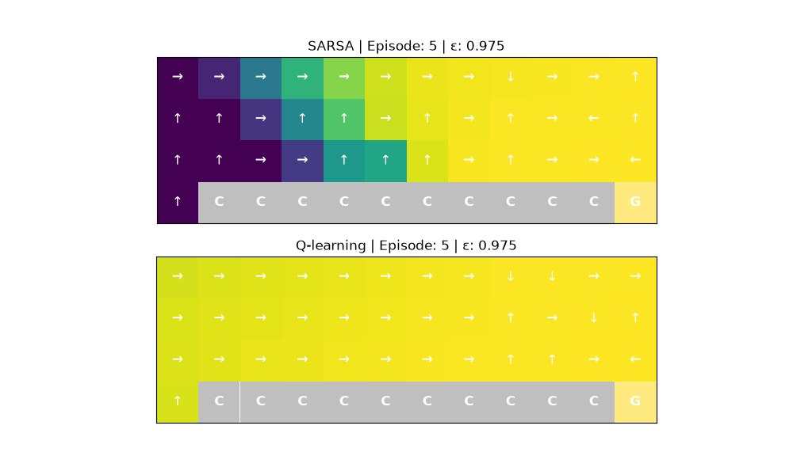
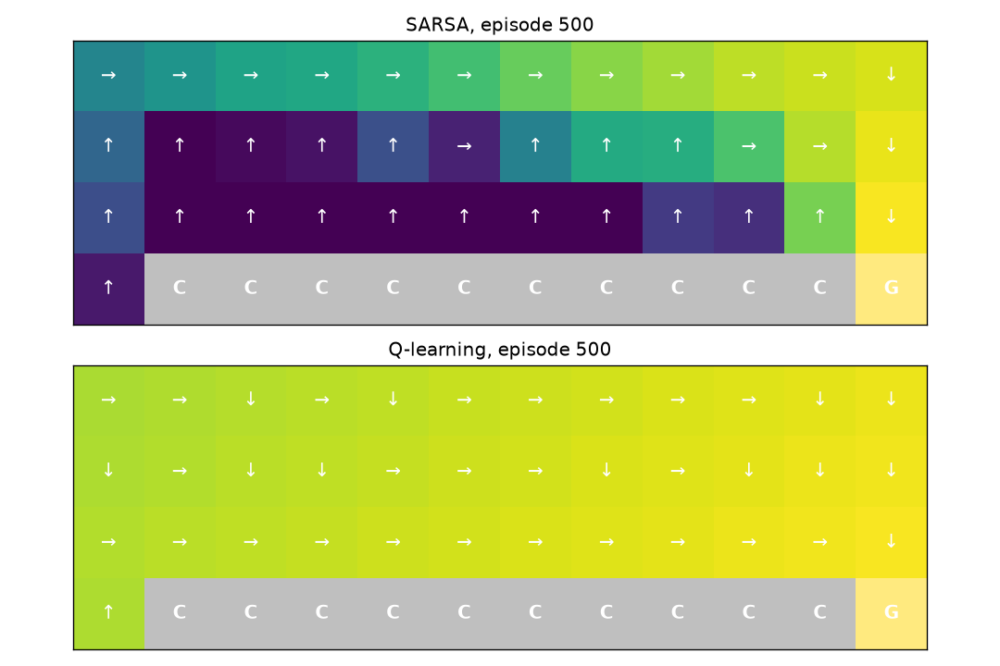
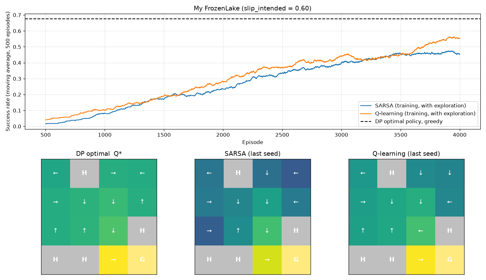

# SARSA & Q-Learning

`check_my_work.py` output
```
Checking sarsa_ql_assignment.py  (student ID 36112: slip = 0.600, map ['SHFF', 'FFFF', 'FFFH', 'HHFG'])
============================================================
[PASS] Student ID is set
[PASS] A: recorder keeps every k-th episode
[PASS] A: heat map draws the right arrows
[PASS] A: video has one frame per snapshot
[PASS] B: Gymnasium-style interface
[PASS] B: walls keep you in place
[PASS] B: model matches Gymnasium (standard map, slippery)
[PASS] B: model matches Gymnasium (standard map, not slippery)
[PASS] B: model is correct for YOUR map and slip
[PASS] B: step() samples from your own P
[PASS] B: time limit sets truncated, not terminated
[PASS] B: same seed gives the same episode
[PASS] C: both agents reach 85% of the optimal value (1 seed)
============================================================
13/13 checks passed.
All checks passed. Now run sarsa_ql_assignment.py and answer Part D.
```
---
`sarsa_ql_assignment.py` output
```
Student ID 36112 -> slip_intended = 0.600, map:
    SHFF
    FFFF
    FFFH
    HHFG

=== Part A: Q-table video on CliffWalking ===

=== Part C: SARSA and Q-learning on my FrozenLake ===
v*(start) = 0.5381   (gamma = 0.99)
Policy                       Value ratio  Worst seed  Success  Time (s)
-----------------------------------------------------------------------
DP optimal                         1.000                0.676
SARSA (lab settings)               0.434       0.295    0.254       0.7
Q-learning (lab settings)          0.446       0.187    0.266       0.8
SARSA (my settings)                0.855       0.809    0.554       4.7
Q-learning (my settings)           0.865       0.865    0.632       9.0
Saved plot -> frozenlake_results.png
SARSA: greedy action differs from DP in states [2, 7, 8]
    state 2: Q*(s, .) = [0.235, 0.479, 0.569, 0.449], learned picks ↓, DP picks →
    state 7: Q*(s, .) = [0.479, 0.235, 0.449, 0.569], learned picks ←, DP picks ↑
    state 8: Q*(s, .) = [0.447, 0.228, 0.462, 0.564], learned picks →, DP picks ↑
Q-learning: greedy action differs from DP in states [2, 3, 7, 10]
    state 2: Q*(s, .) = [0.235, 0.479, 0.569, 0.449], learned picks ↓, DP picks →
    state 3: Q*(s, .) = [0.562, 0.562, 0.557, 0.557], learned picks ↓, DP picks ←
    state 7: Q*(s, .) = [0.479, 0.235, 0.449, 0.569], learned picks ←, DP picks ↑
    state 10: Q*(s, .) = [0.653, 0.657, 0.303, 0.484], learned picks ←, DP picks ↓
```
## PART A - A video of the Q-table while it learns





## PART C -  Make the agents learn on my lake

HYPERPARAMS

```python
HYPERPARAMS = dict(num_episodes=4000, alpha=0.05, gamma=0.99,initial_epsilon=1.0, min_epsilon=0.01, decay_rate=0.999)
```
---



## PART D - QUESTIONS

**Video (Part A)**

1. At which episode does each agent's greedy path from S first reach G? Why does Q-learning's value map settle so much sooner than SARSA's?
> I checked the greedy path from S after every episode. For Q-learning it first reaches G at episode 15 (ε ≈ 0.93) and from episode 19 it always gets there. SARSA first reaches G at episode 38 (ε ≈ 0.83), but it loses the path again after that. In the video (one frame every 5 episodes) the first complete SARSA path is at episode 70, and it only stays complete from around episode 110.
>
> Q-learning settles faster because its target R + γ·max Q(s',a) doesn't care which action the agent actually takes next, so it learns q* directly. CliffWalking is deterministic, so once the −1 rewards have spread back from G the targets basically stop moving. After about episode 200 the value map hardly changes anymore, and the final values are just minus the number of steps to G. SARSA uses R + γ·Q(s',a') where a' is chosen ε-greedily, so sometimes a' is a random step into the cliff (−100) and the target jumps. It's also learning the value of the current ε-greedy policy, and that policy keeps changing while ε decays (ε is still about 0.08 at episode 500). That's why SARSA's map is still changing by 20–50 between frames near the end.

2. Look at the row just above the cliff in the last frame. Why are SARSA's values there so much lower than Q-learning's, even though both agents saw the same kind of experience? What would happen to SARSA's values (and path) if epsilon decayed all the way to 0?
> In the last frame Q-learning's values in that row go from −11.4 up to −1, which is exactly the number of steps left. SARSA's values are much worse, around −200 in the middle of the row (−76, −204, −216, ..., −20, −1).
>
> Both agents fall off the cliff while exploring, but they learn different things from it. SARSA is on-policy, so its values include the chance that its own random action sends it into the cliff. Next to the cliff that chance is always there, so those cells look bad and SARSA's arrows in that row point up. Its greedy path goes along the top row (17 steps). Q-learning uses the max in its target, so it assumes it will act greedily from the next state on, and its own exploration mistakes never show up in the values. It learns the short path right along the cliff (13 steps), even though it actually falls more often during training.
>
> If ε went to 0 (slowly enough that the agent still explores everything), SARSA's next action would always be the greedy one, so its target would be the same as Q-learning's. Then SARSA would also converge to q*, the values above the cliff would go up to −(steps to G) and the path would move down to the cliff edge.

3. CliffWalking and FrozenLake number their actions differently. How did you make sure the arrows in your video are correct?
> I kept two separate dictionaries: CLIFF_ARROWS = {0: ↑, 1: →, 2: ↓, 3: ←} for CliffWalking (Up, Right, Down, Left) and FROZEN_ARROWS = {0: ←, 1: ↓, 2: →, 3: ↑} for FrozenLake (Left, Down, Right, Up). plot_q_heatmap takes the dictionary as an argument, so Part A uses the CliffWalking one and Part C the FrozenLake one. To check it, the self-check "heat map draws the right arrows" passed, and the pictures make sense: Q-learning's final frame shows ↑ from S, → along the cliff and ↓ into G, which is the known optimal path. On FrozenLake the arrows next to holes point away from them, the same as the DP policy. If I had mixed up the dictionaries, the arrows would point into the cliff or into walls.

**Environment (Part B)**

4. Why must the 100-step limit set truncated=True and not terminated=True? Write the TD target for both cases and explain what goes wrong if a truncated episode is treated as terminal.
> The time limit isn't part of the MDP. The state is just the cell the agent is in, it doesn't include the step counter. When time runs out the agent is still on a normal cell and could keep going from there, only H and G are actually terminal.
>
> - terminated (H or G): target = R
> - truncated (time limit): target = R + γ·max_a Q(s',a) for Q-learning, or R + γ·Q(s',a') for SARSA
>
> If truncation was treated as terminal, the same state-action pair would sometimes get γV(s') as its target and sometimes 0, depending only on the step counter, which the agent can't see. This pulls the values down and makes them noisy. On my lake it's even worse, because R = 0 on a timeout, so running out of time would look exactly as bad as falling into a hole. Timeouts mostly happen in safe states where the agent is waiting, for example state 0, where the DP policy just pushes left into the wall. So the agent would learn that playing safe is worth nothing and would start taking riskier moves.

**Learning on your lake (Part C)**

5. Paste your Part C table. Why do the lab settings (500 episodes, decay 0.995, alpha 0.1) fail here? Which change helped most, and why?
> ```
> v*(start) = 0.5381   (gamma = 0.99)
> Policy                       Value ratio  Worst seed  Success  Time (s)
> DP optimal                         1.000                0.676
> SARSA (lab settings)               0.434       0.295    0.254       0.7
> Q-learning (lab settings)          0.446       0.187    0.266       0.8
> SARSA (my settings)                0.855       0.809    0.554       4.7
> Q-learning (my settings)           0.865       0.865    0.632       9.0
> ```
> The lab settings fail because the reward is very sparse (you only get 1 at G) and with slip_intended = 0.6 a mostly random agent almost never gets there. In the plot the success rate at the start of training is only around 2–4%. So in 500 episodes there are just a few successful episodes, and the value from G has to travel back about 6 states to reach S. At the same time ε = 0.995^episode is already 0.08 at episode 500, so the agent stops exploring before its Q-values mean anything. It ends up acting greedily on noisy values, and different seeds get stuck on different bad policies (worst seed only 0.19).
>
> To see which change mattered, I changed one thing at a time starting from the lab settings (mean value ratio over 3 seeds):
>
> | Change | SARSA | Q-learning |
> |---|---|---|
> | lab settings | 0.434 | 0.446 |
> | only 4000 episodes | 0.802 | 0.781 |
> | only decay 0.999 | 0.378 | 0.500 |
> | only alpha 0.05 | 0.430 | 0.322 |
> | 4000 episodes + decay 0.999 | 0.953 | 0.784 |
> | 4000 episodes + alpha 0.05 | 0.507 | 0.503 |
> | my settings (4000, 0.999, 0.05) | 0.855 | 0.865 |
>
> The number of episodes helped the most by far. The main problem is not having enough data, and more episodes means a lot more successful runs, so the value can spread from G back to S. The slower decay only helps when there are also more episodes: with 0.999, ε is about 0.37 at episode 1000, 0.13 at 2000 and 0.02 at 4000, so the agent explores long enough. With only 500 episodes it would still be almost random at the end. The smaller alpha makes updates less noisy on slippery ice, but it also makes learning slower, and together with decay 0.995 it actually made things worse, because ε hits its minimum before the values are learned. My settings still don't reach 0.90. The learning curve is still going up at episode 4000 and the learned Q-values are lower than Q* in the heat maps, so I think training is just too short. When I tried 10000 episodes with decay 0.9995 and alpha 0.1, I got 0.969 for SARSA and 0.953 for Q-learning.

6. The DP-optimal policy maximises the DISCOUNTED return (gamma = 0.99). Can a learned policy reach the goal within 100 steps MORE often than the DP-optimal one but still have a lower value? Explain.
> Yes. Reaching G after T steps is only worth γ^(T−1), so the DP policy is willing to give up a bit of success probability to get there faster. A slower but safer policy can reach G more often within 100 steps and still have a lower discounted value. I checked this on my lake: the DP policy reaches G within 100 steps with probability 0.687 (0.676 in the simulation), but the best possible chance of reaching G within 100 steps is 0.823. That policy waits more and moves along the walls, so it's slower and has lower value. There's also an example from my own agent: Q-learning picks ← in state 10. If I change only that state in the DP policy, the 100-step success goes up from 0.687 to 0.699, but v(start) goes down from 0.538 to 0.521. So the "Success" and "Value ratio" columns measure different things, and DP is only optimal for the discounted value.

7. In which states does your learned greedy policy differ from DP? Use Q*(s, .) printed by Part C to explain why each difference costs little (a near-tie) or why the agent never learned it (a rarely visited state).
> SARSA differs in states 2, 7 and 8, and Q-learning in states 2, 3, 7 and 10. To check how much each one matters I changed only that state in the DP policy and computed v(start) again (v* = 0.538). I also counted visits during training for the last seed (Q-learning / SARSA). For comparison, S was visited about 22800 / 16700 times.
>
> - State 2, Q* = [0.235, 0.479, 0.569, 0.449]: the agents pick ↓, DP picks →. The gap is 0.09, so it isn't a tie, but the state is rarely visited (224 / 140 visits). It's off the main route and you only get there by slipping. v(start) drops to 0.526.
> - State 3, Q* = [0.562, 0.562, 0.557, 0.557]: ↓ instead of ←, but these two are exactly tied, so it costs nothing. It's also rarely visited (407 / 118).
> - State 7, Q* = [0.479, 0.235, 0.449, 0.569]: ← instead of ↑. Going up looks strange because it's away from the goal, but it's the only completely safe move. Hole 11 is right below, and ← slips into it with probability 0.2. The state is rarely visited (1114 / 330), so the agents didn't learn this. v(start) drops to 0.522.
> - State 8, Q* = [0.447, 0.228, 0.462, 0.564]: SARSA picks → instead of ↑. This is the only expensive one (gap 0.10), because → can slip down into hole 12 with probability 0.2. SARSA only visited this state 2665 times and its estimates there haven't converged. Its own values for → and ↑ are 0.273 and 0.243, which is basically noise. v(start) drops to 0.449.
> - State 10, Q* = [0.653, 0.657, 0.303, 0.484]: Q-learning picks ← instead of ↓. This one is visited a lot, but the gap is only 0.004, so noise decides. v(start) drops to 0.521.
>
> So most of the differences are in states that are rarely visited or almost tied, and they cost about 0–3% of v*. The real mistake is SARSA's → in state 8, which is the main reason its last seed only gets 0.81.

8. On CliffWalking SARSA and Q-learning learn different paths. On your FrozenLake they end up almost the same. Explain why.
> In CliffWalking the moves are deterministic, so the optimal path goes right along the cliff. The only danger comes from the agent's own random actions, and only SARSA takes that into account, so it moves away from the edge. On my lake the ice itself is random (the agent slips 40% of the time), so the risk of holes is already part of q*. The optimal policy is already the safe one, and both algorithms are aiming for it.
>
> Exploration is also very small at the end of training. In CliffWalking ε is still about 0.08 at episode 500, but here it's about 0.018 at episode 4000, which is tiny compared to the 40% slip. With ε that small, SARSA's Q(s',a') is almost the same as Q-learning's max Q(s',a), so they both end up near q*. And mistakes are cheaper here: falling into a hole just gives 0 and you lose a reward of at most 1, while in CliffWalking a fall costs −100, which is what pushes SARSA so far from the edge.
>
> Because of this, both learned policies match DP on the main route (0 ←, 4 →, 5 ↓, 9 ↑, 14 →) and only differ in the rarely visited or almost tied states from question 7.
